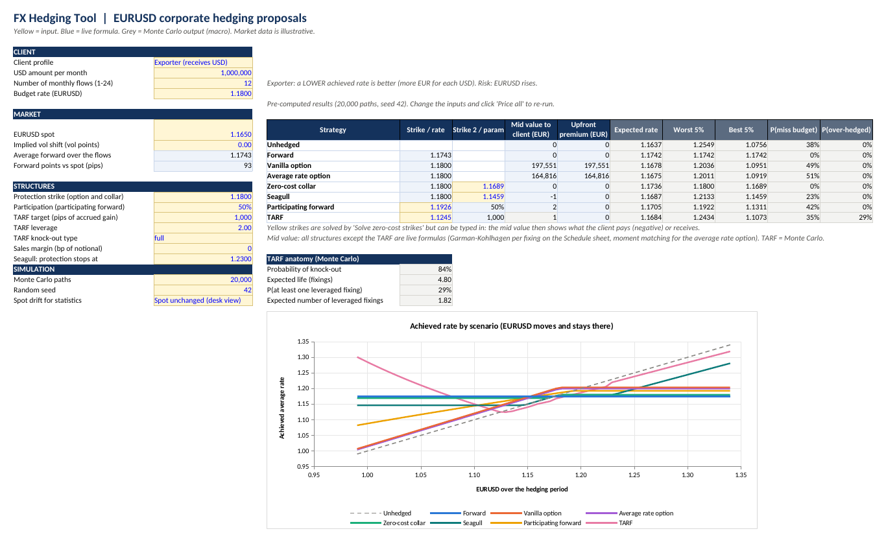
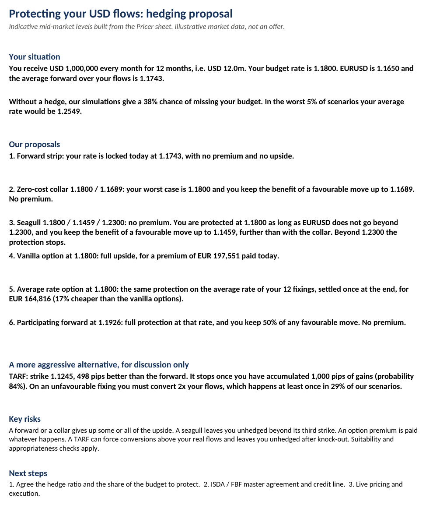

# FX Hedging Tool (Excel / VBA)

An Excel pricer of the kind an FX sales uses with a corporate treasurer. It takes the
company's monthly USD flows and compares the five standard hedges: **forward, vanilla
option, zero-cost collar, participating forward and TARF**. It solves the zero-cost strikes,
prices the option premium with the volatility smile, runs a Monte Carlo of the outcomes and
writes a one-page client pitch that updates with the inputs.

Closed-form pricing is done with **live worksheet formulas**: forwards, discount factors, smile
vols, Garman-Kohlhagen d1/d2 and option prices for each fixing, the mid values, the premium,
the scenario grid and the pitch text. Change the spot, a strike or the vol and everything
moves at once. VBA only does what a formula cannot: **solving the zero-cost strikes** and the
**Monte Carlo** (TARF value and outcome statistics). No add-in and no external library.



## How to use

1. Download `FX_Hedging_Tool.xlsm`. If Excel shows "Microsoft has blocked macros", right-click
   the file, choose Properties, tick **Unblock**, then reopen it.
2. Enable macros.
3. On the **Pricer** sheet, fill the yellow cells: exporter or importer, USD amount per month,
   number of months, budget rate, spot, protection strike, TARF terms and sales margin.
4. The forward, option, collar and participating forward update instantly (formulas).
5. Click **Solve zero-cost strikes** to re-solve the collar give-up, the participating forward
   strike and the TARF strike, or type your own strikes in the yellow cells: the mid value then
   shows what the client pays or receives.
6. Click **Run Monte Carlo** to refresh the TARF value and the statistics (expected rate, worst
   and best 5%, probability of missing the budget). **Price all** does both. A 20,000-path run
   takes a few seconds in Excel.

| Sheet | Content | Computed by |
|---|---|---|
| Pricer | inputs, comparison table, TARF anatomy, scenario chart | formulas + Monte Carlo columns |
| Pitch | client one-pager written from the results (prints on one A4 page) | formulas |
| Schedule | per fixing: forward, discount factors, smile vol, d1, d2, option prices and values | formulas |
| Scenarios | achieved rate per structure if EURUSD moves by -15% to +15% and stays there | formulas |
| Distribution | Monte Carlo outcomes sorted from best to worst, per structure | macro |
| Market | editable curves and smile (ATM, 25d RR, 25d BF), forwards and a smile check | formulas |
| Notes | conventions, methodology, what is a formula and what is VBA | |

## Default case

A French exporter receives **USD 1m per month for 12 months**, with a budget rate of 1.1800.
EURUSD is at 1.1650 and the 12-month average forward is 1.1743. Market data is illustrative.

| Strategy | Strike(s) | Premium (EUR) | Expected rate | Worst 5% | Best 5% | P(miss budget) |
|---|---|---:|---:|---:|---:|---:|
| Unhedged | | 0 | 1.1637 | 1.2549 | 1.0756 | 38% |
| Forward | 1.1743 | 0 | 1.1742 | 1.1742 | 1.1742 | 0% |
| Vanilla option | 1.1800 | 197,551 | 1.1678 | 1.2036 | 1.0951 | 49% |
| Zero-cost collar | 1.1800 / 1.1689 | 0 | 1.1736 | 1.1800 | 1.1689 | 0% |
| Participating forward | 1.1926, 50% | 0 | 1.1705 | 1.1922 | 1.1311 | 42% |
| TARF | 1.1245, 1,000 pips, 2x | 0 | 1.1684 | 1.2434 | 1.1073 | 35% |

For an exporter, a lower rate is better (more EUR per USD). The TARF knocks out in 84% of
scenarios after 4.8 fixings on average, and in 29% of scenarios the client must convert twice
its flows at least once.

The same model is implemented in Python in the companion project `fx_hedging`. The two give
the same option premium (EUR 197,550.66) and the same zero-cost strikes to four decimals. The
Monte Carlo statistics differ only by simulation noise, since the random generators are
different.



## VBA code

```
vba/
  modMath.bas        MRG32k3a random generator, inverse normal (Acklam), normal CDF (Hart),
                     interpolation, quicksort, percentiles
  modMarket.bas      curves, forwards, ATM term structure, smile, Garman-Kohlhagen,
                     worksheet functions FX_FORWARD, FX_POINTS, FX_VOL, FX_OPTION, FX_AVGFWD,
                     FX_DFDOM, FX_DFFOR, FX_ATMVOL (used by the Schedule formulas)
  modStrategies.bas  forward, option, collar, participating forward, TARF payoffs; bisection solvers
  modMonteCarlo.bas  antithetic log-normal paths, TARF pricing and zero-cost strike
  modMain.bas        buttons: SolveZeroCost, RunMonteCarlo, PriceAll, SetDefaultStrike
tools/               Python scripts that assemble the .xlsm from vba/ (layout, charts, VBA project)
```

The `.bas` files are the source code. You can also import them into any workbook from the VBA
editor (File > Import File).

## Methodology

- **Forwards**: covered interest parity, `F(T) = S x DF_EUR(T) / DF_USD(T)`.
- **Worksheet functions**: curve interpolation and the smile (which needs a fixed-point
  iteration) are VBA functions called from cells, e.g. `=FX_VOL(T, K)`. Everything else in the
  pricing is plain Excel (`EXP`, `LN`, `SQRT`, `NORMSDIST`, `SUMPRODUCT`).
- **Smile**: implied vol is a quadratic in forward delta through ATM, 25d RR and 25d BF. It is
  solved by fixed-point iteration, because delta depends on the vol. ATM vols are interpolated
  in total variance.
- **One formula for every structure**: each hedge is a set of conversion legs, where n USD are
  converted at a hedge rate R instead of the spot S. The EUR gain of a leg is
  `phi x n x (1/R - 1/S)`, with phi = +1 for an exporter and -1 for an importer. The mid value
  is `sum DF_USD(t) / S0 x E[gain x S(t)]`, which makes a forward at market worth exactly zero.
- **Zero-cost strikes**: the collar give-up strike, the participating forward strike and the
  TARF strike are found by bisection, net of an optional sales margin. The TARF uses common
  random numbers so the solver sees a smooth function.
- **Statistics**: by default the spot is expected to stay where it is (desk view: forward
  points are a carry cost, not a forecast). Pricing always uses the risk-neutral forward.
- **Random numbers**: MRG32k3a with antithetic variates, so the same seed gives the same
  results on every machine and Excel version.

## Limitations

- The TARF is priced without the smile. A local-vol model would move its zero-cost strike by
  tens of pips.
- Rates are deterministic and there is no business-day calendar.
- Zero-cost means zero-cost mid-market: no CVA or capital charge.
- The market data is illustrative.

## Rebuilding the workbook

The workbook is generated from the `.bas` files by `tools/build_workbook.py` (XlsxWriter and
the `ms_ovba` package, with a spec-compliant MS-OVBA compressor in `tools/ovba_compress.py`).
The macros were tested by running them in LibreOffice. Their results match the Python
implementation.
